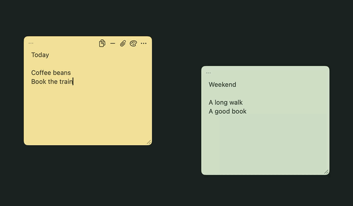
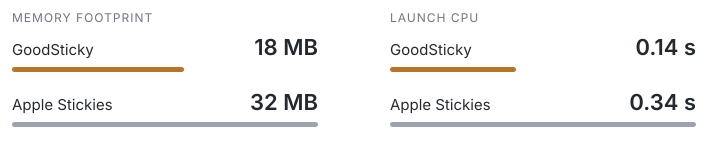

<p align="center">
  <a href="https://prathje.github.io/plushies/?scene=video&amp;design=live"></a>
</p>

<h1 align="center">GoodSticky</h1>

<p align="center">Native, lightweight sticky notes for macOS.<br>Made for personal use because Apple Stickies sucks.</p>

<p align="center"></p>

<p align="center"></p>

<sub>Median of 3 warm launches, 1 visible note each. M1 Max, macOS 27.0.1. CPU is app process time, not launch latency; excludes WindowServer. GoodSticky’s sample includes an image.</sub>

macOS 13+ with Swift command-line tools. Quit the running app, then:

```sh
./scripts/install.sh
```

⌃⌥N creates a note · ⌘W hides it · ⌘Z / ⌘⇧Z undo / redo. Undo survives hiding and stacking until you quit the app.

Tests: `./scripts/test.sh` and `./scripts/test-install.sh`.
